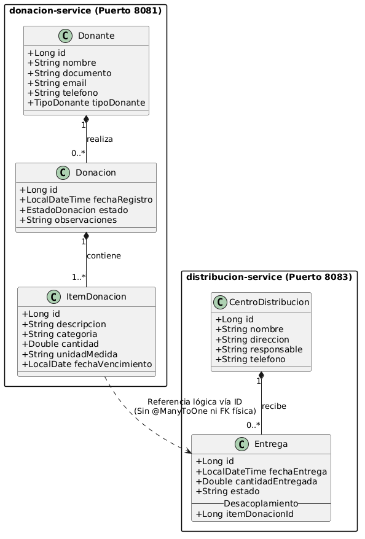
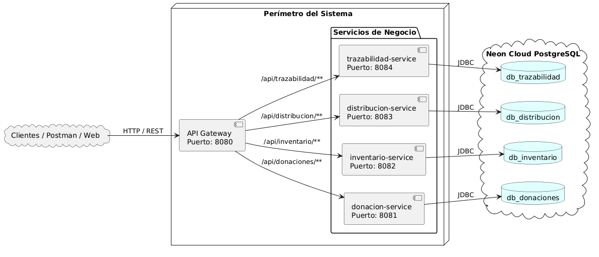

# Sistema de Trazabilidad de Alimentos - Banco de Alimentos

 Descripción del Proyecto
Backend distribuido para la gestión y trazabilidad del flujo de donaciones alimentarias, desarrollado con Spring Boot y PostgreSQL en Neon Cloud.

 Integrantes
* Cristian Leonel Cabrera
* Rocha lucas nicolas

 Arquitectura del Sistema
El sistema adopta el patrón **Database-per-Service**, desacoplando los dominios y permitiendo persistencia independiente:

| Microservicio | Puerto | Base de Datos (Neon) | Estado |
| :--- | :--- | :--- | :--- |
| API Gateway | 8080 | N/A | Pendiente |
| donacion-service | 8081 | donacion_db | En desarrollo |
| inventario-service | 8082 | inventario_db | Pendiente |
| distribucion-service | 8083 | distribucion_db | Pendiente |
| trazabilidad-service | 8084 | trazabilidad_db | Pendiente |
| solicitud-service | 8085 | solicitud_db | Pendiente |

##Diagramas del Sistema
### Modelo de Dominio y Clases

### Arquitectura de Microservicios

 Avances - Semana 1 (29/10)
* Inicialización del repositorio y configuración de Git en equipo.
* Creación de las 5 bases de datos en Neon PostgreSQL.
* Estructuración inicial y conexión de `donacion-service`.
