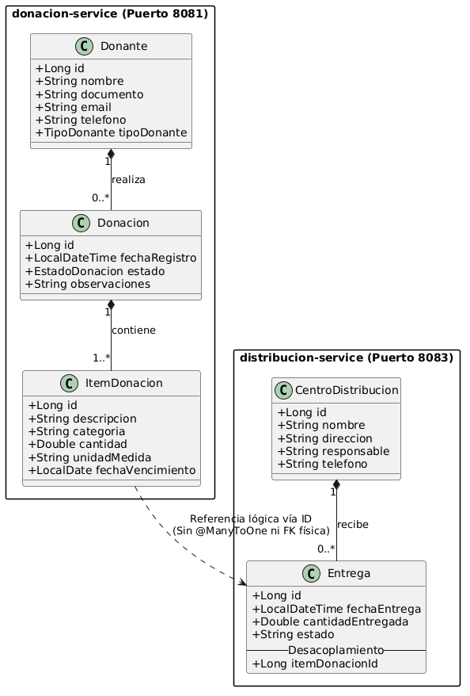
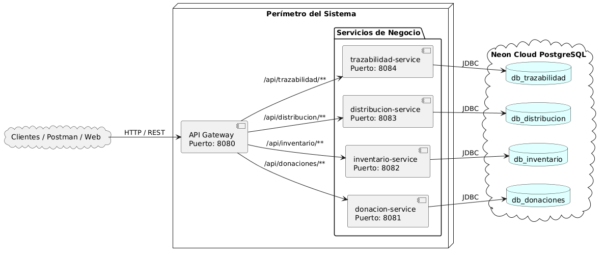

# Sistema de Trazabilidad de Alimentos - Banco de Alimentos

 Descripción del Proyecto
Backend distribuido para la gestión y trazabilidad del flujo de donaciones alimentarias, desarrollado con Spring Boot y PostgreSQL en Neon Cloud.

 Integrantes
* Cristian Leonel Cabrera
* Rocha lucas nicolas

 Arquitectura del Sistema
El sistema adopta el patrón **Database-per-Service**, desacoplando los dominios y permitiendo persistencia independiente:

| Microservicio | Puerto | Base de Datos (Neon) | Estado |
| :--- | :--- | :--- | :--- |
| API Gateway | 8080 | N/A | Pendiente |
| donacion-service | 8081 | donacion_db | En desarrollo |
| inventario-service | 8082 | inventario_db | Completado |
| distribucion-service | 8083 | distribucion_db | Pendiente |
| trazabilidad-service | 8084 | trazabilidad_db | Pendiente |
| solicitud-service | 8085 | solicitud_db | Pendiente |

 Avances - Semana 1 (29/10)
* Inicialización del repositorio y configuración de Git en equipo.
* Creación de las 5 bases de datos en Neon PostgreSQL.
* Estructuración inicial y conexión de `donacion-service`.

Avances - Semana 2 (03/11)
* Desarrollo completo del microservicio `inventario-service` (arquitectura en 3 capas).
* Configuración de persistencia en PostgreSQL (Neon Cloud) con Hibernate y Spring Data JPA.
* Implementación y verificación de endpoints REST (`POST /api/lotes`, `GET /api/lotes`).

## rDiagramas del Sistema
### Modelo de Dominio y Clases


### Arquitectura de Microservicios


---

## Especificación: inventario-service

### Descripción
Servicio encargado del registro, consulta y control de existencias de lotes de insumos y alimentos donados. Opera de forma desacoplada con su propia base de datos PostgreSQL alojada en Neon.

* **Puerto:** `8082`
* **Base de datos:** `inventario_db` (Neon Cloud)
* **Persistencia:** Spring Data JPA / Hibernate (`ddl-auto: update`)

### Estructura de Paquetes
* **`model/Lote.java`:** Entidad JPA mapeada a la tabla `lotes`.
* **`repository/LoteRepository.java`:** Repositorio con consultas derivadas (`findByDonacionId`, `findByCategoria`).
* **`service/LotesService.java`:** Capa de negocio con asignación automática de fecha de ingreso.
* **`controller/LoteController.java`:** Controlador REST con serialización JSON.

### Endpoints y Pruebas (cURL)

**Alta de lote (`POST /api/lotes`):**
```bash
curl -X POST http://localhost:8082/api/lotes \
  -H "Content-Type: application/json" \
  -d '{"descripcion":"Leche larga vida 1L","categoria":"Lacteos","cantidad":100.0,"unidadMedida":"LITROS","fechaVencimiento":"2027-08-15","donacionId":1}'
```

**Listar stock (`GET /api/lotes`):**
```bash
curl http://localhost:8082/api/lotes
```